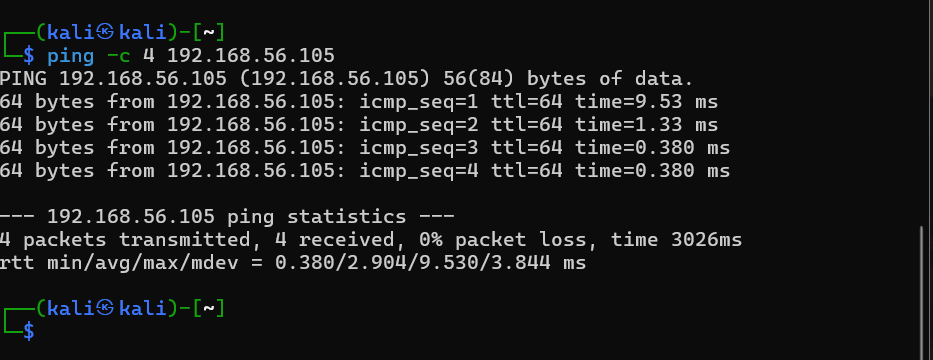
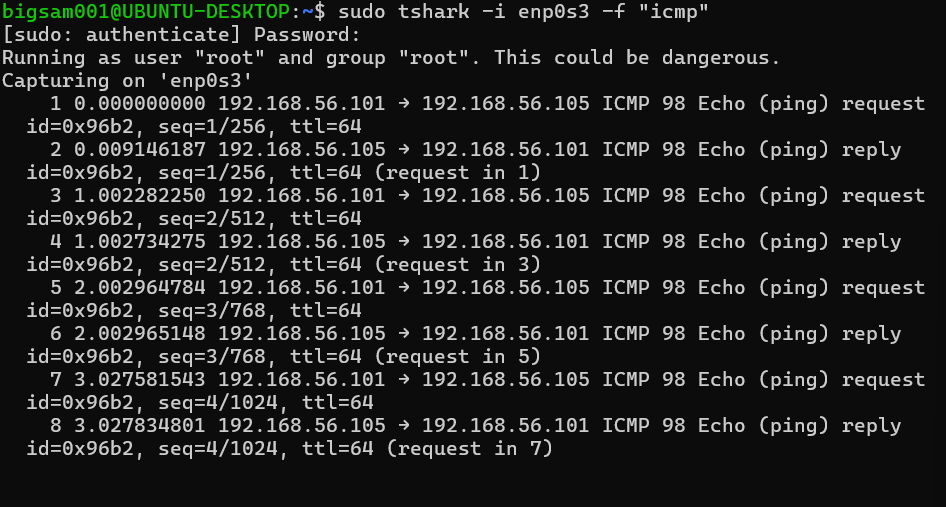
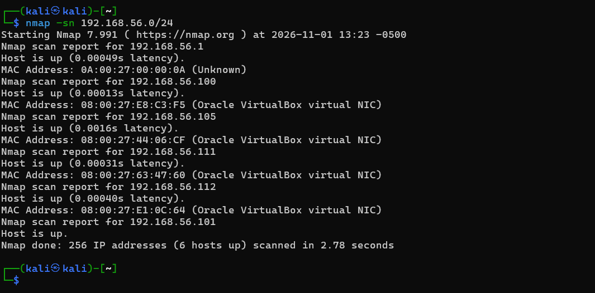
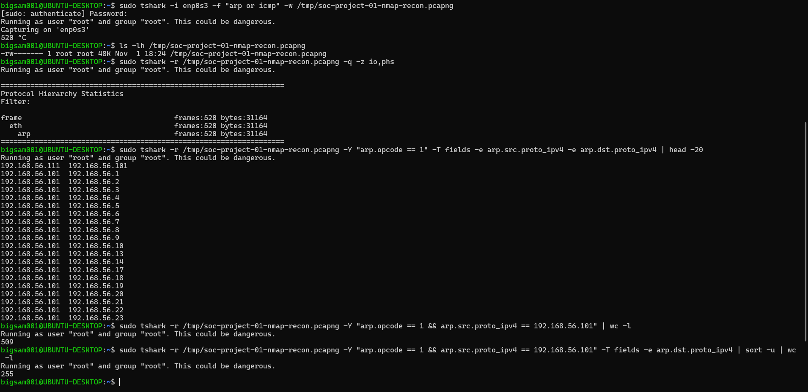

# SOC Level 1 – Project 01: Detecting Network Reconnaissance Using Nmap and TShark

## 1. Project Overview

This project involved simulating internal network reconnaissance in an isolated VirtualBox lab environment. Kali Linux was used to perform network discovery with Nmap, while Ubuntu Desktop was configured to capture and analyse network traffic using TShark.

The investigation focused on identifying reconnaissance activity, analysing ARP traffic, identifying the scanning source, and determining the number of unique IP addresses queried.

## 2. Project Objectives

- Verify connectivity between the scanning machine and target.
- Perform network host discovery using Nmap.
- Capture network traffic using TShark.
- Identify ARP requests originating from the scanning machine.
- Analyse destination IP addresses and network discovery patterns.
- Interpret findings from a SOC analyst perspective.

## 3. Lab Environment

The lab was configured using Oracle VirtualBox with an isolated host-only network.

| Machine | IP Address | Role |
|---|---|---|
| Kali Linux | 192.168.56.101 | Attacker / Scanning machine |
| Metasploitable 2 | 192.168.56.105 | Vulnerable target |
| Ubuntu Desktop | 192.168.56.111 | Network monitoring and packet analysis |
| Ubuntu Server | 192.168.56.112 | Wazuh Manager |
| VirtualBox Network | 192.168.56.0/24 | Isolated lab subnet |

## 4. Tools and Technologies

- **Kali Linux:** Scanning and security testing environment.
- **Nmap:** Network discovery and host identification.
- **TShark:** Packet capture and network traffic analysis.
- **Metasploitable 2:** Intentionally vulnerable target machine.
- **Ubuntu Desktop:** Network monitoring workstation.
- **Oracle VirtualBox:** Virtual lab infrastructure.

## 5. Investigation Methodology

### Step 1: Verify Network Connectivity

Before beginning reconnaissance, I verified connectivity between Kali Linux and Metasploitable 2 using ICMP ping.

Command executed on Kali Linux:

`ping -c 4 192.168.56.105`

**Results:**
- Target IP: 192.168.56.105
- Packets transmitted: 4
- Packets received: 4
- Packet loss: 0%

**Observation:** Successful ICMP responses confirmed that Kali Linux could communicate with the Metasploitable 2 target over the isolated lab network.

### Step 2: Perform Network Host Discovery

Executed the following command on Kali Linux:

`nmap -sn 192.168.56.0/24`

The `-sn` option performs host discovery without conducting a port scan.

**Results:**

Nmap identified six active hosts:

| IP Address | Identified Device |
|---|---|
| 192.168.56.1 | Unknown – requires verification |
| 192.168.56.100 | VirtualBox virtual NIC – identity unconfirmed |
| 192.168.56.101 | Kali Linux |
| 192.168.56.105 | Metasploitable 2 |
| 192.168.56.111 | Ubuntu Desktop |
| 192.168.56.112 | Ubuntu Server |

**Observation:** The scan identified multiple active systems within the lab subnet, demonstrating network host-discovery activity.

### Step 3: Capture Network Traffic

Ubuntu Desktop was configured to monitor network traffic on interface `enp0s3`.

Command executed:

`sudo tshark -i enp0s3 -f "arp or icmp" -w /tmp/soc-project-01-nmap-recon.pcapng`

The capture filter collected ARP and ICMP packets and saved them for subsequent investigation.

### Step 4: Analyse Captured Protocols

Analysed the saved capture using:

`sudo tshark -r /tmp/soc-project-01-nmap-recon.pcapng -q -z io,phs`

**Protocol analysis results:**

| Protocol | Frames | Bytes |
|---|---:|---:|
| Ethernet | 520 | 31,164 |
| ARP | 520 | 31,164 |
| ICMP | 0 | 0 |

**Observation:** The capture contained 520 ARP frames and no ICMP frames. This indicates that ARP was the observed protocol used for host discovery during this capture.

### Step 5: Identify the Source of ARP Requests

To identify ARP requests originating from Kali Linux, I applied the following display filter:

`sudo tshark -r /tmp/soc-project-01-nmap-recon.pcapng -Y "arp.opcode == 1 && arp.src.proto_ipv4 == 192.168.56.101" | wc -l`

**Result:** 509 ARP requests originated from Kali Linux.

### Step 6: Identify Unique Destination IP Addresses

To determine the number of unique destination IP addresses queried by Kali, I executed:

`sudo tshark -r /tmp/soc-project-01-nmap-recon.pcapng -Y "arp.opcode == 1 && arp.src.proto_ipv4 == 192.168.56.101" -T fields -e arp.dst.proto_ipv4 | sort -u | wc -l`

**Result:** 255 unique destination IP addresses were queried.

**Observation:** The high volume of ARP requests directed towards multiple unique IP addresses is consistent with network reconnaissance and host-discovery activity.

## 6. Key Investigation Findings

The investigation established the following:

- Successful connectivity between Kali Linux and Metasploitable 2 was verified.
- Nmap discovered six active hosts within the `192.168.56.0/24` subnet.
- TShark captured 520 ARP frames.
- 509 ARP requests originated from Kali Linux (`192.168.56.101`).
- Kali queried 255 unique destination IP addresses.
- Ubuntu Desktop successfully observed the reconnaissance-related network traffic.

## 7. Security Significance

In a production environment, a workstation generating a high volume of ARP requests across multiple IP addresses may indicate network reconnaissance.

Such activity could represent an authorised network inventory operation or potentially suspicious host discovery by an attacker.

A SOC analyst should investigate the source endpoint, establish whether the activity was authorised, and correlate network traffic with endpoint and SIEM logs.

## 8. Security Recommendations

- Monitor unusual ARP request volumes across internal networks.
- Identify endpoints generating repeated network discovery traffic.
- Investigate unauthorised host-discovery activity.
- Correlate network events with endpoint security and SIEM alerts.
- Escalate suspicious reconnaissance activity for further investigation.

## 9. Skills Demonstrated

- Network connectivity testing using ICMP.
- Nmap host discovery and reconnaissance.
- Packet capture using TShark.
- ARP traffic filtering and analysis.
- Identification of source and destination IP addresses.
- Network traffic interpretation.
- Basic SOC investigation and security reporting.

## 10. Conclusion

This project provided practical experience in identifying network reconnaissance through host discovery and packet-level traffic analysis.

By combining Nmap and TShark, I demonstrated how a SOC analyst can identify the source of network discovery activity, examine ARP traffic, quantify destination diversity, and interpret potential reconnaissance behaviour within an isolated network environment.
## Evidence and Screenshots

### 1. Network Connectivity Test – Kali to Metasploitable 2

### 2. ICMP Traffic Capture Using TShark

### 3. Nmap Host Discovery

### 4. TShark ARP Investigation Analysis

