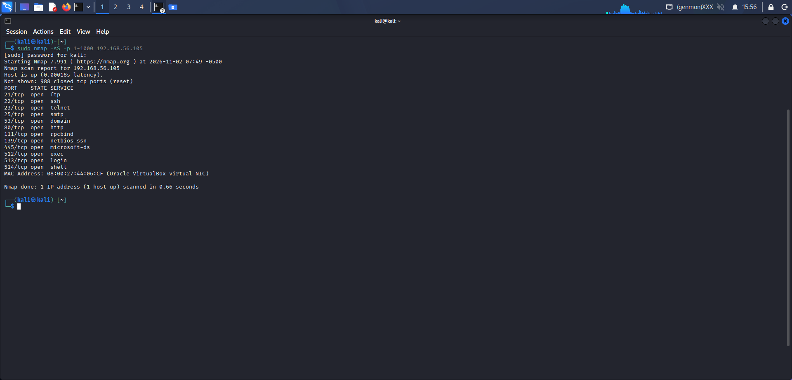
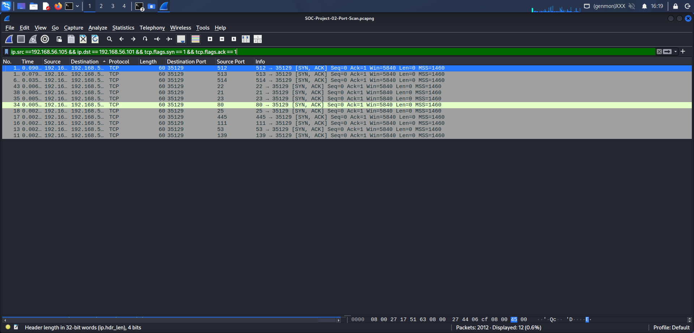
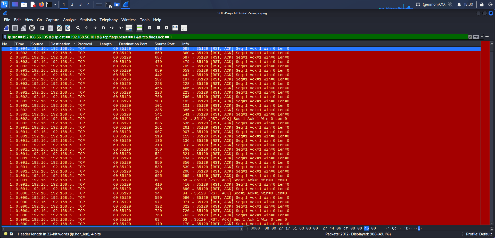

# SOC Lab Project 02: Detecting TCP Port Scanning Using Nmap and Wireshark

## 1. Project Overview

This project demonstrates how a SOC Analyst can identify and investigate TCP port scanning activity using Nmap and Wireshark in a controlled virtual lab environment.

The objective was to simulate network reconnaissance, capture the resulting traffic, and analyse TCP flags to identify open and closed ports on a target system.

## 2. Lab Environment

| Machine | IP Address | Role |
|---|---|---|
| Kali Linux | `192.168.56.101` | Scanning machine |
| Metasploitable 2 | `192.168.56.105` | Target machine |

**Tools used:**
- Nmap – Network scanning and service discovery.
- Wireshark – Packet capture and traffic analysis.
- VirtualBox – Virtual lab environment.

## 3. Methodology

### Step 1: TCP SYN Scan with Nmap

Executed the following command from Kali Linux:

```bash
sudo nmap -sS -p 1-1000 192.168.56.105
```

**Command breakdown:**
- `sudo` – Runs Nmap with elevated privileges.
- `nmap` – Network scanning tool.
- `-sS` – Performs a TCP SYN scan.
- `-p 1-1000` – Scans TCP ports 1 through 1000.
- `192.168.56.105` – Target IP address.

### Step 2: Packet Capture with Wireshark

Started Wireshark on Kali Linux's host-only network interface (`eth1`) before running the scan.

Used the capture filter:

```text
tcp
```

After the scan, applied display filters to isolate traffic between the scanning machine and the target.

**SYN-ACK responses (open ports):**

```text
ip.src == 192.168.56.105 && ip.dst == 192.168.56.101 && tcp.flags.syn == 1 && tcp.flags.ack == 1
```

**RST responses (closed ports):**

```text
ip.src == 192.168.56.105 && ip.dst == 192.168.56.101 && tcp.flags.reset == 1
```

## 4. Findings and Analysis

Nmap scanned 1,000 TCP ports and identified:

- **12 open TCP ports**
- **988 closed TCP ports**
- Target host confirmed online.
- Scan completed in approximately 0.68 seconds.

**Open ports identified:**

| Port | Service |
|---|---|
| 21 | FTP |
| 22 | SSH |
| 23 | Telnet |
| 25 | SMTP |
| 53 | DNS |
| 80 | HTTP |
| 111 | RPCBind |
| 139 | NetBIOS |
| 445 | SMB |
| 512 | Remote execution |
| 513 | Remote login |
| 514 | Remote shell |

Wireshark analysis confirmed the TCP response patterns:

- **SYN:** Initial connection probes sent by Kali Linux.
- **SYN-ACK:** Responses from the target indicating open ports.
- **RST-ACK:** Responses from the target indicating closed ports.

The SYN scan did not complete the normal TCP three-way handshake for each scanned port.

## 5. Security Observations

The scan demonstrated how an attacker could use network reconnaissance to identify exposed services before attempting further activity.

Services such as Telnet, FTP, SMB, and legacy remote-shell services may introduce security risks if improperly configured or exposed.

From a SOC perspective, repeated connection attempts from one source to numerous destination ports can be an indicator of port-scanning activity.

## 6. Recommendations

- Monitor for unusual bursts of TCP SYN packets.
- Investigate systems probing multiple ports across a short period.
- Identify and restrict unnecessary exposed services.
- Replace insecure legacy services such as Telnet with secure alternatives.
- Correlate source IPs, destination ports, and TCP response flags during investigations.

## 7. Skills Demonstrated

- TCP SYN scan execution using Nmap.
- Network packet capture and analysis using Wireshark.
- TCP flag interpretation (SYN, SYN-ACK, RST-ACK).
- Open and closed port identification.
- Network reconnaissance detection.
- Basic SOC investigation and security reporting.

## 8. Evidence

### Nmap TCP SYN Scan Results



### Wireshark Open Port Analysis



### Wireshark Closed Port Analysis



## 9. Conclusion

This exercise provided practical experience identifying TCP port-scanning activity through network traffic analysis. By combining Nmap scan results with Wireshark packet inspection, I demonstrated how a SOC Analyst can recognise reconnaissance behaviour and identify potentially exposed network services in a controlled lab environment.
