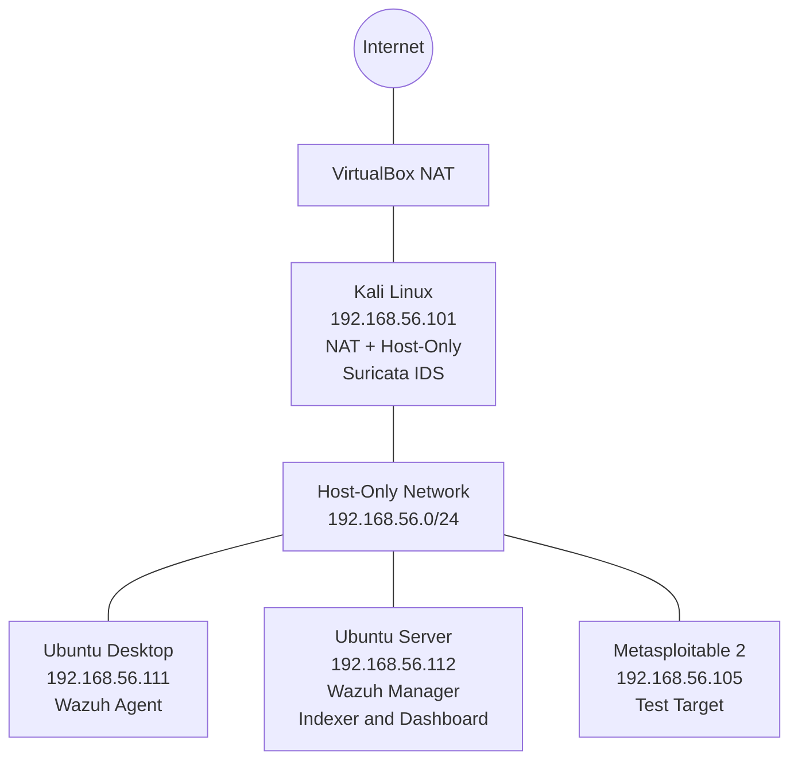

# Building a SOC Home Lab with Wazuh SIEM and Suricata IDS

## 1. Project Overview

This project demonstrates the design and implementation of a virtual cybersecurity home lab using Oracle VirtualBox, Wazuh SIEM, and Suricata IDS.

The objective was to build a centralized security monitoring environment where endpoint security events and network intrusion detection events could be collected and investigated.

The lab consists of multiple virtual machines configured to support security monitoring, network traffic analysis, and controlled testing.

**Key objectives:**
- Design an isolated virtual SOC lab environment.
- Deploy Wazuh Manager, Indexer, and Dashboard.
- Install and connect Wazuh agents to the central manager.
- Deploy Suricata IDS to monitor network traffic.
- Integrate Suricata EVE JSON logs with the Wazuh agent.
- Verify that Suricata events appear in the Wazuh Dashboard.

## 2. Home Lab SOC Setup

### Virtualization Platform

- **Platform:** Oracle VirtualBox
- **Network:** Host-Only Network
- **Lab subnet:** `192.168.56.0/24`
- **Gateway:** Kali Linux (`192.168.56.101`) for Ubuntu Desktop and Ubuntu Server.

### Virtual Machine Configuration

| Virtual Machine | IP Address | Role |
|---|---|---|
| Kali Linux | `192.168.56.101` | Security testing, network gateway and Suricata IDS |
| Ubuntu Desktop | `192.168.56.111` | Wazuh agent and monitoring workstation |
| Ubuntu Server | `192.168.56.112` | Wazuh Manager, Indexer and Dashboard |
| Metasploitable 2 | `192.168.56.105` | Vulnerable test machine |

### Network Architecture

Kali Linux was configured with two network adapters:

- **Adapter 1 – NAT:** Provides internet connectivity.
- **Adapter 2 – Host-Only:** Connects Kali to the private SOC lab network.

Kali Linux also serves as the default gateway for Ubuntu Desktop and Ubuntu Server. Metasploitable 2 is connected to the host-only network but is not configured to route through Kali.



The Ubuntu Desktop and Ubuntu Server use Kali Linux (`192.168.56.101`) as their configured default gateway. Metasploitable 2 is connected to the same host-only subnet without that gateway configuration.

This environment provides a controlled platform for testing network activity, collecting security telemetry, and investigating events centrally through Wazuh.

## 3. Wazuh SIEM Deployment

Wazuh was deployed on the Ubuntu Server (`192.168.56.112`) as the central Security Information and Event Management (SIEM) platform.

The deployment used the Wazuh all-in-one installation method, placing the following components on the same server:

| Component | Function |
|---|---|
| Wazuh Manager | Receives and analyses security events from connected agents. |
| Wazuh Indexer | Stores and indexes security data for searching and analysis. |
| Wazuh Dashboard | Provides the web interface for monitoring, alert analysis, and investigation. |

### 3.1 Wazuh Installation Procedure

The Wazuh installation assistant provides an automated method for deploying the central components on one server.

The following commands document the reproducible installation procedure:

```bash
sudo apt update
sudo apt upgrade -y
```

Download the Wazuh installation assistant:

```bash
curl -sO https://packages.wazuh.com/4.14/wazuh-install.sh
```

Run the all-in-one installation:

```bash
sudo bash ./wazuh-install.sh -a
```

**Documentation note:** These commands document the standard installation procedure retrospectively. They are not claimed to be the exact historical commands used during the original deployment.

### 3.2 Installation Verification

The installed Wazuh version was checked using:

```bash
sudo /var/ossec/bin/wazuh-control info
```

The verified server version was:

- Wazuh Version: `4.14.9`
- Revision: `rc2`
- Installation Type: `server`

The central services were checked using:

```bash
sudo systemctl status wazuh-manager wazuh-indexer wazuh-dashboard
```

All three services were confirmed as active on the Ubuntu Server.
**Outcome:** Successfully established the central Wazuh SIEM infrastructure for collecting, indexing, and investigating security telemetry from the lab endpoints.

### 3.3 Retrieving Wazuh Dashboard Login Credentials

During the Wazuh installation, the installation script automatically generated administrator credentials for dashboard access.

To retrieve the generated credentials, the following command was executed on the Ubuntu Server:

```bash
sudo tar -O -xvf wazuh-install-files.tar wazuh-install-files/wazuh-passwords.txt
```

The command extracts and displays the generated credentials, including the `admin` username and password.

These credentials were then used to authenticate and access the Wazuh Dashboard through a web browser.

**Security Note:** Administrator credentials were kept private and excluded from the GitHub repository.
## 4. Wazuh Agent Installation and Configuration

Wazuh Agents were deployed on Kali Linux and Ubuntu Desktop to collect endpoint security data and forward events to the central Wazuh Manager running on Ubuntu Server (`192.168.56.112`).

### 4.1 Agent Deployment Environment

| Endpoint | IP Address | Wazuh Version | Role |
|---|---|---|---|
| Kali Linux | `192.168.56.101` | `4.14.9` | Endpoint and Suricata log collection |
| Ubuntu Desktop | `192.168.56.111` | `4.14.9` | Endpoint monitoring |
| Ubuntu Server | `192.168.56.112` | `4.14.9` | Central Wazuh Manager |

### 4.2 Configuring the Wazuh APT Repository

The Wazuh repository and signing key were configured to allow installation of the Wazuh Agent package.

Install the required packages:

```bash
sudo apt update
sudo apt install curl gnupg apt-transport-https -y
```

Import the Wazuh signing key:

```bash
curl -s https://packages.wazuh.com/key/GPG-KEY-WAZUH | \
sudo gpg --no-default-keyring \
--keyring gnupg-ring:/usr/share/keyrings/wazuh.gpg --import

sudo chmod 644 /usr/share/keyrings/wazuh.gpg
```

Add the Wazuh repository:

```bash
echo "deb [signed-by=/usr/share/keyrings/wazuh.gpg] https://packages.wazuh.com/4.x/apt/ stable main" | \
sudo tee /etc/apt/sources.list.d/wazuh.list

sudo apt update
```

### 4.3 Installing the Wazuh Agent

The same Wazuh Agent version (`4.14.9`) was deployed across Kali Linux and Ubuntu Desktop to maintain version consistency with the Wazuh Manager.

Install the agent:

```bash
sudo WAZUH_MANAGER="192.168.56.112" apt install wazuh-agent=4.14.9-1
```

Enable and start the agent service:

```bash
sudo systemctl daemon-reload
sudo systemctl enable wazuh-agent
sudo systemctl start wazuh-agent
```

### 4.4 Agent Verification

Check the agent service:

```bash
sudo systemctl status wazuh-agent
```

Verify the installed version:

```bash
sudo /var/ossec/bin/wazuh-control info
```

The deployed agents were verified with the following version information:

- Wazuh Version: `4.14.9`
- Revision: `rc2`
- Type: `agent`

**Outcome:** Successfully deployed and configured Wazuh Agents on Kali Linux and Ubuntu Desktop, using the same version as the central Wazuh Manager for consistent endpoint monitoring and security event collection.
## 5. Suricata Installation and Event Logging

### 5.1 Installation

Suricata was deployed on Kali Linux (`192.168.56.101`) to monitor network traffic on the host-only lab interface.

The following commands represent the installation procedure:

```bash
sudo apt update
sudo apt install suricata -y
```

Verify the installation:

```bash
suricata --version
```

### 5.2 Service Verification

The Suricata service was checked to confirm that it was running:

```bash
sudo systemctl status suricata
```

**Result:** The Suricata service was confirmed as active and running.

### 5.3 EVE JSON Logging

Suricata records network security events in its EVE JSON log file:

```text
/var/log/suricata/eve.json
```

The log was inspected using:

```bash
sudo tail -n 5 /var/log/suricata/eve.json
```

The captured events included network flow and statistics records. The `in_iface` field showed `eth1`, confirming that the recorded traffic was associated with the lab network interface.

### 5.4 Event Processing Statistics

The inspected Suricata statistics included:

- **Rules loaded:** 53,230
- **Rules failed:** 0
- **Kernel packet drops:** 0

These results confirmed that Suricata was processing network traffic and writing event data to its EVE JSON log.

## 6. Wazuh-Suricata Integration

### 6.1 Configuring Wazuh to Collect Suricata Logs

To forward Suricata events to the Wazuh Manager, the Wazuh Agent on Kali Linux was configured to monitor Suricata's EVE JSON log.

Configuration file:

```bash
sudo nano /var/ossec/etc/ossec.conf
```

The following configuration was added inside the `<ossec_config>` section:

```xml
<localfile>
    <log_format>json</log_format>
    <location>/var/log/suricata/eve.json</location>
</localfile>
```

This configuration instructs the Wazuh Agent to read Suricata's JSON event log.

### 6.2 Restarting the Wazuh Agent

After saving the configuration, the agent was restarted:

```bash
sudo systemctl restart wazuh-agent
```

The service status was checked:

```bash
sudo systemctl status wazuh-agent
```

**Result:** The Wazuh Agent was confirmed as active and running.

### 6.3 Verifying Events in Wazuh Dashboard

The Wazuh Dashboard was accessed from the Ubuntu Server.

Under **Threat Hunting**, the following filters were used:
- Agent: `kali` (Agent ID: `004`)
- Time range: Last 24 hours

Suricata-generated events were visible in the dashboard, including:

- `ET INFO Spotify P2P Client`
- `ET INFO Possible Kali Linux hostname in DHCP Request Packet`

Both events appeared with Wazuh rule ID `86601` and rule level `3`.

**Analysis:** These are informational Suricata signatures. Their presence confirms event forwarding and visibility in Wazuh; they should not automatically be interpreted as malicious activity.

### 6.4 Integration Outcome

The integration successfully enabled centralized visibility of Suricata network events through Wazuh, allowing security events generated on Kali Linux to be reviewed in the SIEM dashboard.
## 7. Final Integration Verification and Results

After completing the Wazuh and Suricata integration, validation was performed to confirm that the SOC monitoring environment was operational.

### 7.1 Verification Summary

| Component | Verification | Result |
|---|---|---|
| Wazuh Manager | Checked manager, indexer, and dashboard services | Active |
| Kali Linux Agent | Checked agent version and service status | Active, version 4.14.9 |
| Ubuntu Desktop Agent | Checked agent version and service status | Active, version 4.14.9 |
| Suricata IDS | Checked service status | Active |
| Suricata EVE JSON | Inspected `/var/log/suricata/eve.json` | Events generated |
| Wazuh–Suricata Integration | Searched for Suricata events in Wazuh Threat Hunting | Events received and displayed |

### 7.2 Evidence from the Wazuh Dashboard

The Wazuh Dashboard was used to review events from the Kali Linux agent.

The investigation returned 51 event hits within the selected Last 24 Hours time range. Suricata-generated alerts were visible, including:

- `ET INFO Spotify P2P Client`
- `ET INFO Possible Kali Linux hostname in DHCP Request Packet`

The displayed events included Wazuh rule ID `86601`, with a severity level of `3`.

These informational alerts demonstrated that Suricata events were successfully reaching the Wazuh monitoring platform.

### 7.3 Final Project Outcome

The SOC home lab successfully demonstrated:

1. Deployment of a centralized Wazuh SIEM environment.
2. Installation and connection of Linux endpoint agents.
3. Deployment of Suricata as a network intrusion detection system.
4. Configuration of Wazuh to collect Suricata EVE JSON logs.
5. Centralized visibility of Suricata-generated events through the Wazuh Dashboard.

**Conclusion:** This project established a functional home-based SOC monitoring environment using open-source security tools. It provided practical experience in SIEM deployment, endpoint monitoring, network intrusion detection, log collection, event forwarding, and security event analysis.
## 8. Skills Demonstrated and Key Takeaways

### 8.1 Technical Skills Demonstrated

Through this project, I gained practical experience in the following areas:

- **SIEM Deployment:** Installed and configured Wazuh Manager, Indexer, and Dashboard.
- **Endpoint Monitoring:** Deployed and configured Wazuh Agents on Kali Linux and Ubuntu Desktop.
- **Linux Administration:** Worked with APT package management, systemd services, configuration files, and Linux troubleshooting.
- **Network Intrusion Detection:** Installed and configured Suricata to monitor network traffic.
- **Log Collection and Analysis:** Worked with Suricata EVE JSON logs and configured Wazuh to collect security events.
- **SIEM Integration:** Integrated Suricata with Wazuh for centralized security event monitoring.
- **Security Event Investigation:** Used Wazuh Threat Hunting to review and interpret Suricata-generated events.
- **Troubleshooting:** Resolved Wazuh repository signing and package-version issues during agent maintenance.

### 8.2 Tools and Technologies

| Tool | Purpose |
|---|---|
| Wazuh | Security Information and Event Management (SIEM) |
| Suricata | Network Intrusion Detection System (IDS) |
| Kali Linux | Security testing and monitoring environment |
| Ubuntu Server | Wazuh Manager, Indexer, and Dashboard |
| Ubuntu Desktop | Monitored endpoint |
| VirtualBox | Virtualized SOC lab environment |
| Linux CLI | Installation, configuration, and troubleshooting |

### 8.3 Key Takeaways

This project strengthened my understanding of how security monitoring components work together in a Security Operations Center (SOC).

I learned how to deploy a SIEM platform, connect monitored endpoints, configure an IDS to generate network security events, forward logs to a central monitoring platform, and investigate the resulting events.

Most importantly, I gained hands-on experience building and troubleshooting a multi-machine SOC home lab using open-source security technologies.
