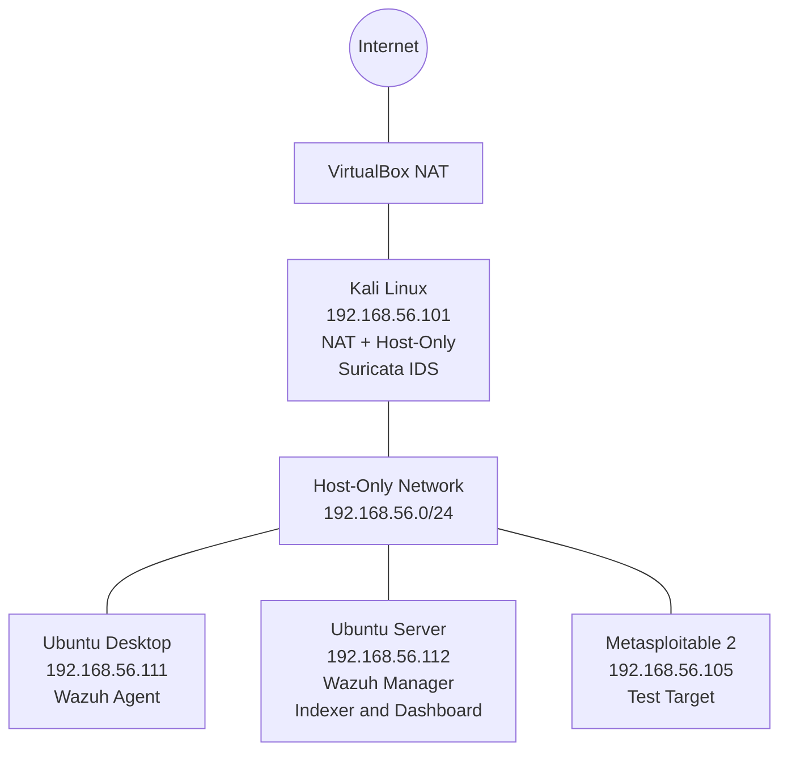

# Building a SOC Home Lab with Wazuh SIEM and Suricata IDS

## 1. Project Overview

This project demonstrates the design and implementation of a virtual cybersecurity home lab using Oracle VirtualBox, Wazuh SIEM, and Suricata IDS.

The objective was to build a centralized security monitoring environment where endpoint security events and network intrusion detection events could be collected and investigated.

The lab consists of multiple virtual machines configured to support security monitoring, network traffic analysis, and controlled testing.

**Key objectives:**
- Design an isolated virtual SOC lab environment.
- Deploy Wazuh Manager, Indexer, and Dashboard.
- Install and connect Wazuh agents to the central manager.
- Deploy Suricata IDS to monitor network traffic.
- Integrate Suricata EVE JSON logs with the Wazuh agent.
- Verify that Suricata events appear in the Wazuh Dashboard.

## 2. Home Lab SOC Setup

### Virtualization Platform

- **Platform:** Oracle VirtualBox
- **Network:** Host-Only Network
- **Lab subnet:** `192.168.56.0/24`
- **Gateway:** Kali Linux (`192.168.56.101`) for Ubuntu Desktop and Ubuntu Server.

### Virtual Machine Configuration

| Virtual Machine | IP Address | Role |
|---|---|---|
| Kali Linux | `192.168.56.101` | Security testing, network gateway and Suricata IDS |
| Ubuntu Desktop | `192.168.56.111` | Wazuh agent and monitoring workstation |
| Ubuntu Server | `192.168.56.112` | Wazuh Manager, Indexer and Dashboard |
| Metasploitable 2 | `192.168.56.105` | Vulnerable test machine |

### Network Architecture

Kali Linux was configured with two network adapters:

- **Adapter 1 – NAT:** Provides internet connectivity.
- **Adapter 2 – Host-Only:** Connects Kali to the private SOC lab network.

Kali Linux also serves as the default gateway for Ubuntu Desktop and Ubuntu Server. Metasploitable 2 is connected to the host-only network but is not configured to route through Kali.

The Ubuntu Desktop and Ubuntu Server use Kali Linux (`192.168.56.101`) as their configured default gateway. Metasploitable 2 is connected to the same host-only subnet without that gateway configuration.

This environment provides a controlled platform for testing network activity, collecting security telemetry, and investigating events centrally through Wazuh.
