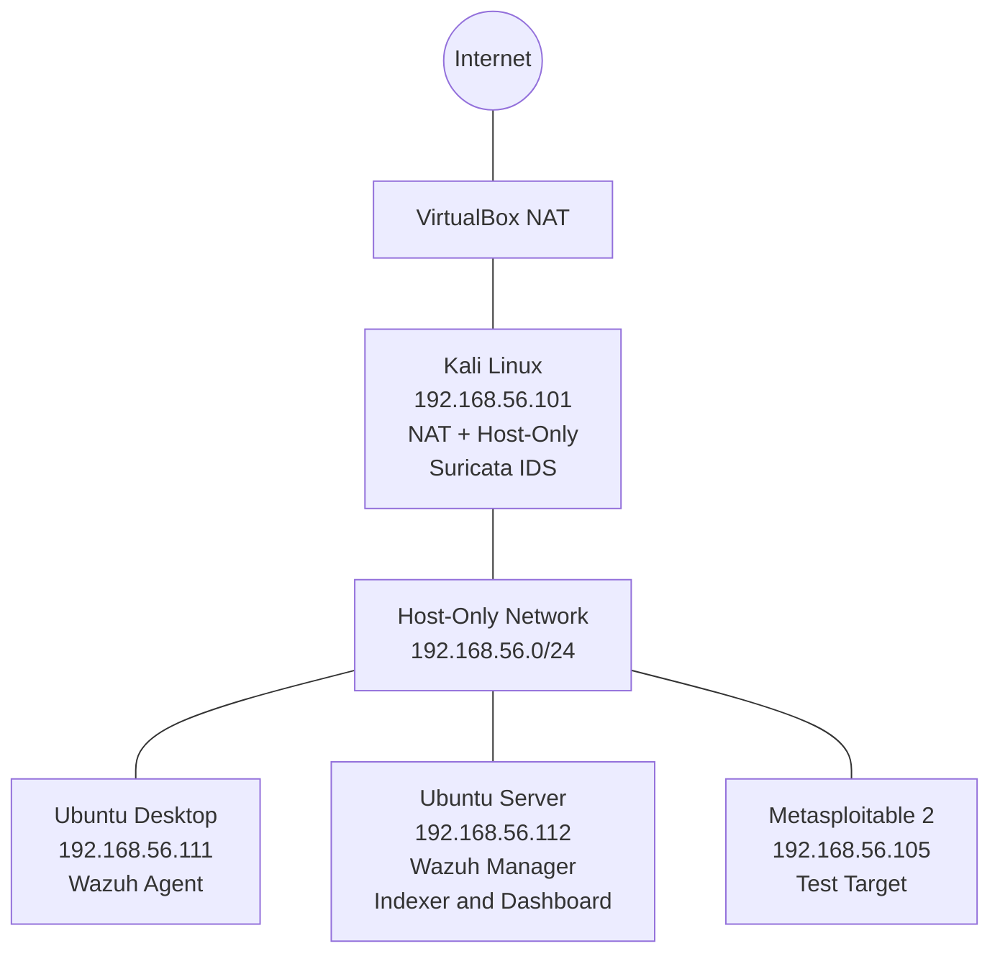

# Building a SOC Home Lab with Wazuh SIEM and Suricata IDS

## 1. Project Overview

This project demonstrates the design and implementation of a virtual cybersecurity home lab using Oracle VirtualBox, Wazuh SIEM, and Suricata IDS.

The objective was to build a centralized security monitoring environment where endpoint security events and network intrusion detection events could be collected and investigated.

The lab consists of multiple virtual machines configured to support security monitoring, network traffic analysis, and controlled testing.

**Key objectives:**
- Design an isolated virtual SOC lab environment.
- Deploy Wazuh Manager, Indexer, and Dashboard.
- Install and connect Wazuh agents to the central manager.
- Deploy Suricata IDS to monitor network traffic.
- Integrate Suricata EVE JSON logs with the Wazuh agent.
- Verify that Suricata events appear in the Wazuh Dashboard.

## 2. Home Lab SOC Setup

### Virtualization Platform

- **Platform:** Oracle VirtualBox
- **Network:** Host-Only Network
- **Lab subnet:** `192.168.56.0/24`
- **Gateway:** Kali Linux (`192.168.56.101`) for Ubuntu Desktop and Ubuntu Server.

### Virtual Machine Configuration

| Virtual Machine | IP Address | Role |
|---|---|---|
| Kali Linux | `192.168.56.101` | Security testing, network gateway and Suricata IDS |
| Ubuntu Desktop | `192.168.56.111` | Wazuh agent and monitoring workstation |
| Ubuntu Server | `192.168.56.112` | Wazuh Manager, Indexer and Dashboard |
| Metasploitable 2 | `192.168.56.105` | Vulnerable test machine |

### Network Architecture

Kali Linux was configured with two network adapters:

- **Adapter 1 – NAT:** Provides internet connectivity.
- **Adapter 2 – Host-Only:** Connects Kali to the private SOC lab network.

Kali Linux also serves as the default gateway for Ubuntu Desktop and Ubuntu Server. Metasploitable 2 is connected to the host-only network but is not configured to route through Kali.



The Ubuntu Desktop and Ubuntu Server use Kali Linux (`192.168.56.101`) as their configured default gateway. Metasploitable 2 is connected to the same host-only subnet without that gateway configuration.

This environment provides a controlled platform for testing network activity, collecting security telemetry, and investigating events centrally through Wazuh.

## 3. Wazuh SIEM Deployment

Wazuh was deployed on the Ubuntu Server (`192.168.56.112`) as the central Security Information and Event Management (SIEM) platform.

The deployment consists of three main components:

| Component | Function |
|---|---|
| Wazuh Manager | Collects and analyses security events from connected agents. |
| Wazuh Indexer | Stores and indexes security event data for searching and analysis. |
| Wazuh Dashboard | Provides a web interface for security monitoring, alert analysis, and investigation. |

### Service Verification

After installation, I verified that the three Wazuh services were running successfully using:

```bash
sudo systemctl status wazuh-manager wazuh-indexer wazuh-dashboard
```

All three services were confirmed as active on the Ubuntu Server.

This established the central SIEM infrastructure for receiving and investigating security telemetry from the lab environment.
## 4. Wazuh Agent Installation and Configuration

Wazuh agents were deployed on Kali Linux and Ubuntu Desktop to collect endpoint logs and forward security events to the Wazuh Manager running on Ubuntu Server.

### 4.1 Agent Deployment Environment

| Endpoint | IP Address | Wazuh Agent Version | Role |
|---|---|---|---|
| Kali Linux | `192.168.56.101` | `4.14.9` | Suricata log collection |
| Ubuntu Desktop | `192.168.56.111` | `4.14.9` | Endpoint monitoring |
| Ubuntu Server | `192.168.56.112` | `4.14.9` | Wazuh Manager |

### 4.2 Adding the Wazuh APT Repository

The Wazuh repository and signing key were configured on the Linux endpoints to allow installation and management of the Wazuh Agent package.

```bash
sudo apt update
sudo apt install curl gnupg apt-transport-https -y
```

Import the Wazuh repository signing key:

```bash
curl -s https://packages.wazuh.com/key/GPG-KEY-WAZUH | \
sudo gpg --no-default-keyring \
--keyring gnupg-ring:/usr/share/keyrings/wazuh.gpg --import

sudo chmod 644 /usr/share/keyrings/wazuh.gpg
```

Add the Wazuh repository:

```bash
echo "deb [signed-by=/usr/share/keyrings/wazuh.gpg] https://packages.wazuh.com/4.x/apt/ stable main" | \
sudo tee /etc/apt/sources.list.d/wazuh.list

sudo apt update
```

### 4.3 Installing and Configuring the Agent

The Wazuh Agent was installed and configured to communicate with the Wazuh Manager at `192.168.56.112`.

```bash
sudo WAZUH_MANAGER="192.168.56.112" apt install wazuh-agent
```

Enable and start the agent service:

```bash
sudo systemctl daemon-reload
sudo systemctl enable wazuh-agent
sudo systemctl start wazuh-agent
```

### 4.4 Agent Verification

The agent service and installed version were checked using:

```bash
sudo systemctl status wazuh-agent
sudo /var/ossec/bin/wazuh-control info
```

The deployed agents were verified as Wazuh version `4.14.9` (revision `rc2`).

### 4.5 Ubuntu Desktop Agent Upgrade and Repository Troubleshooting

During verification, the Ubuntu Desktop endpoint was initially running Wazuh Agent `4.14.6`, while the other components were on `4.14.9`.

Investigation revealed that the Wazuh APT repository was disabled. The repository was enabled, the Wazuh signing key was imported, and the `Signed-By` repository configuration was corrected.

The agent was then upgraded using:

```bash
sudo apt update
sudo apt install wazuh-agent=4.14.9-1
```

The upgrade was verified with the Wazuh version command and systemd service status. The agent reported version `4.14.9` and its service was active and running.

**Outcome:** The Wazuh Manager and both Linux agents were aligned on version `4.14.9`, providing a consistent SIEM deployment across the lab endpoints.
